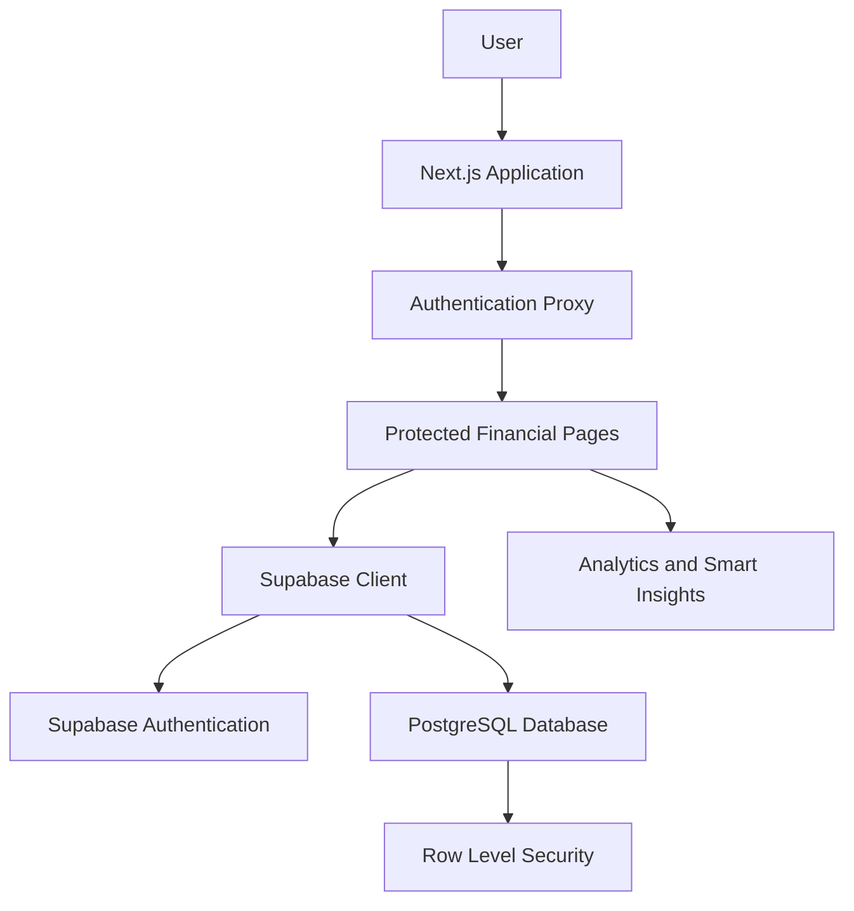

# SpendWise

### Master your money. Live with clarity.

SpendWise is a modern personal finance management web application designed to simplify expense tracking, budgeting, savings, and financial decision-making.

## Live Demo

[Explore SpendWise](https://spend-wise-theta-eosin.vercel.app)

## Features

- **Financial Dashboard** — Overview of income, expenses, and net balance.
- **Transaction Management** — Add, edit, delete, and organize transactions.
- **Budget Management** — Set spending limits and monitor expenses.
- **Savings Goals** — Create financial goals and track progress.
- **Recurring Transactions** — Manage recurring income and expenses.
- **Smart Insights** — Understand financial patterns and spending behavior.
- **Analytics** — Visualize financial activity through interactive charts.
- **Data Import & Export** — Import and export financial records using Excel and CSV.
- **User Authentication** — Account registration, login, logout, and profile management.
- **Responsive Design** — Consistent interface across desktop and mobile devices.

## Technology Stack

| Layer | Technology |
|---|---|
| Frontend | Next.js, React |
| Language | TypeScript |
| Styling | Tailwind CSS |
| Database | PostgreSQL |
| Backend Services | Supabase |
| Authentication | Supabase Auth |
| Data Visualization | Recharts |
| Icons | Lucide React |
| Spreadsheet Processing | SheetJS |
| Deployment | Vercel |
| Version Control | Git & GitHub |

## System Architecture



## Security

- Supabase-based authentication.
- Protected application routes.
- PostgreSQL Row Level Security.
- User-specific database access policies.
- Ownership checks for financial record operations.
- Environment-based configuration.

## Design Philosophy

SpendWise follows a soft minimal aesthetic that prioritizes clarity, usability, and visual consistency.

- Ivory, sage green, and charcoal color palette.
- Playfair Display and Manrope typography.
- Responsive navigation.
- Minimalist financial visualizations.
- Accessible form controls.

## Local Development

Clone the repository:

```bash
git clone https://github.com/iRachitKaushik/SpendWise.git
cd SpendWise/frontend
npm install
```

Create a `.env.local` file:

```env
NEXT_PUBLIC_SUPABASE_URL=your_supabase_url
NEXT_PUBLIC_SUPABASE_PUBLISHABLE_KEY=your_publishable_key
```

The Supabase project must have the required database tables
and Row Level Security policies configured.

Start the development server:

```bash
npm run dev
```

Open http://localhost:3000

Create a production build:

```bash
npm run build
```

## Project Structure

```text
SpendWise/
└── frontend/
    └── src/
        ├── app/
        │   ├── dashboard/
        │   ├── transactions/
        │   ├── budgets/
        │   ├── goals/
        │   ├── recurring/
        │   ├── insights/
        │   ├── analytics/
        │   ├── settings/
        │   └── login/
        ├── components/
        ├── lib/
        └── proxy.ts
```

## Project Objective

SpendWise was developed to make personal finance management
more organized, accessible, and understandable while exploring
full-stack application development, database security,
product design, and modern web technologies.

---

**SpendWise — Money, made clear.**
